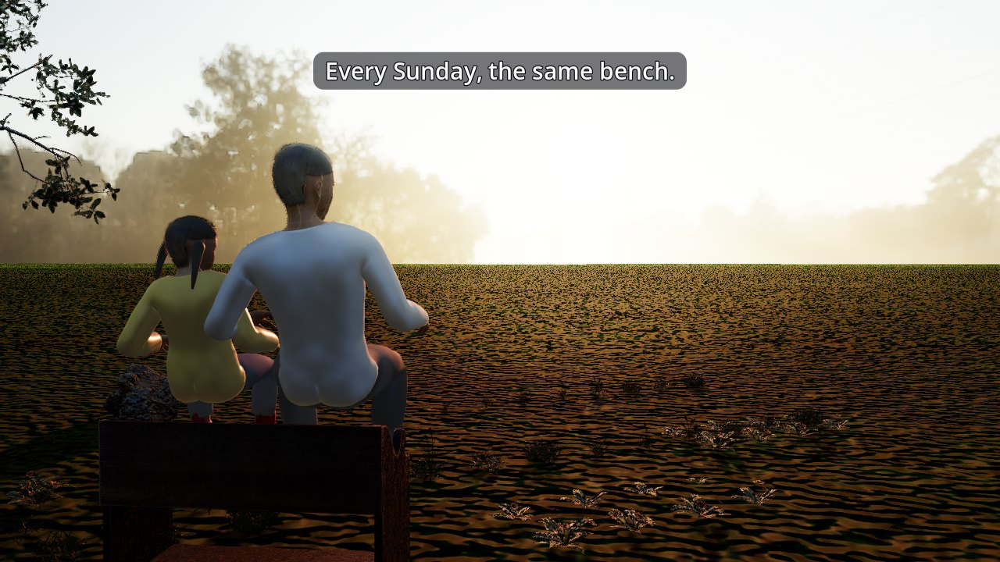
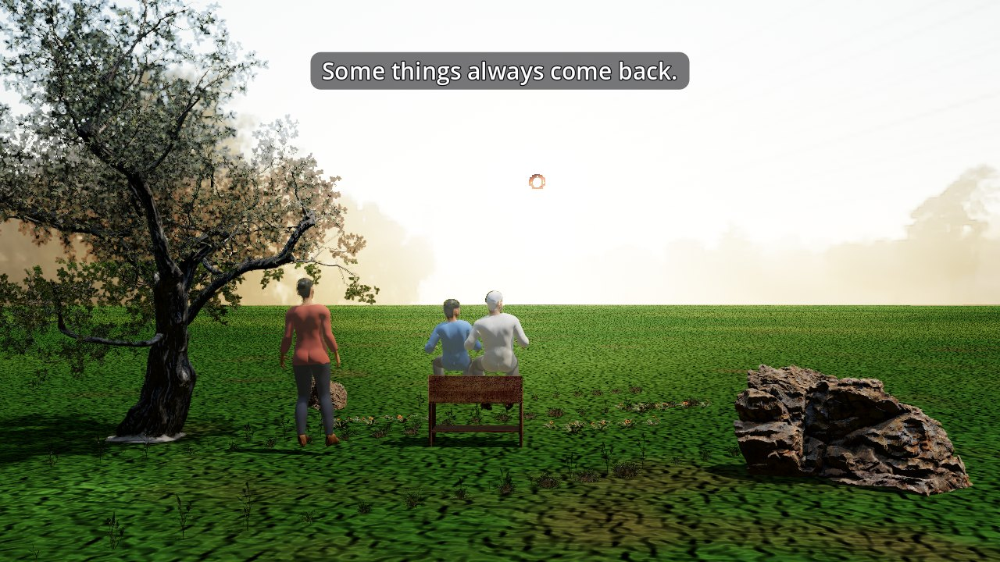
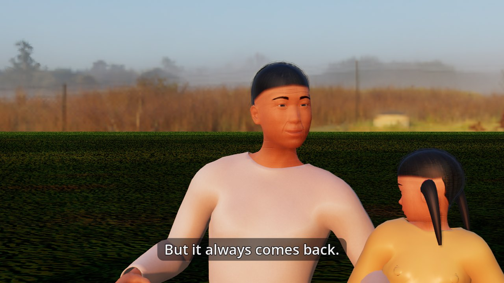
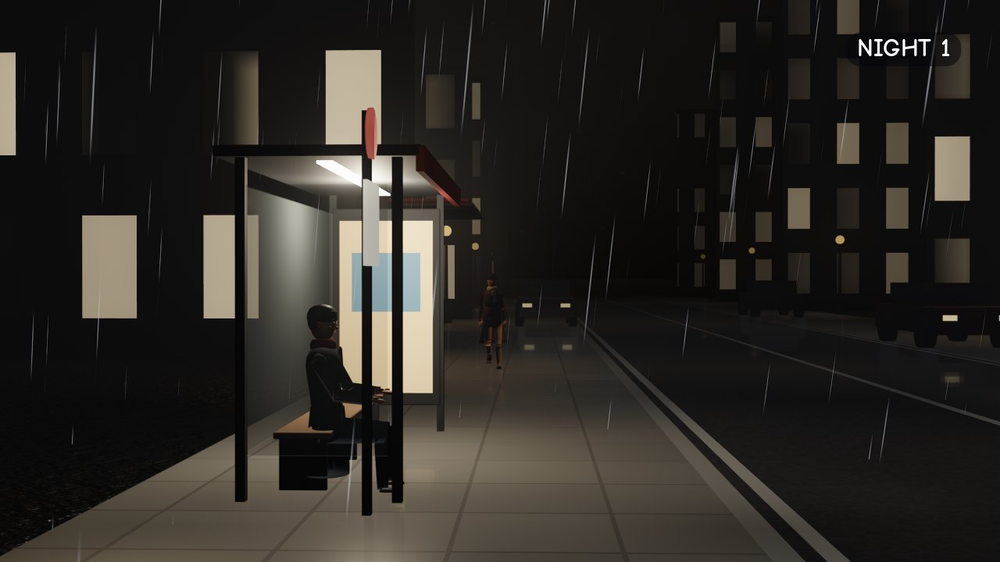
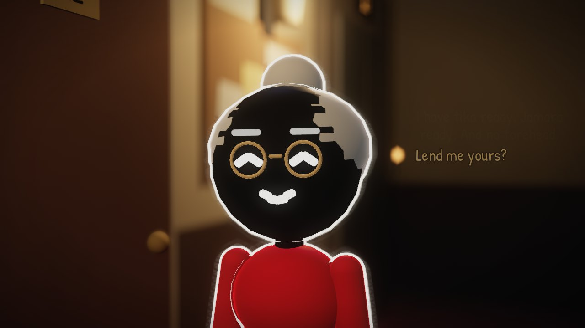
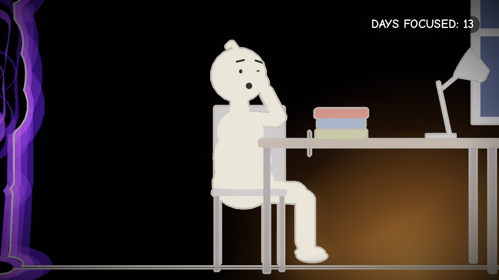
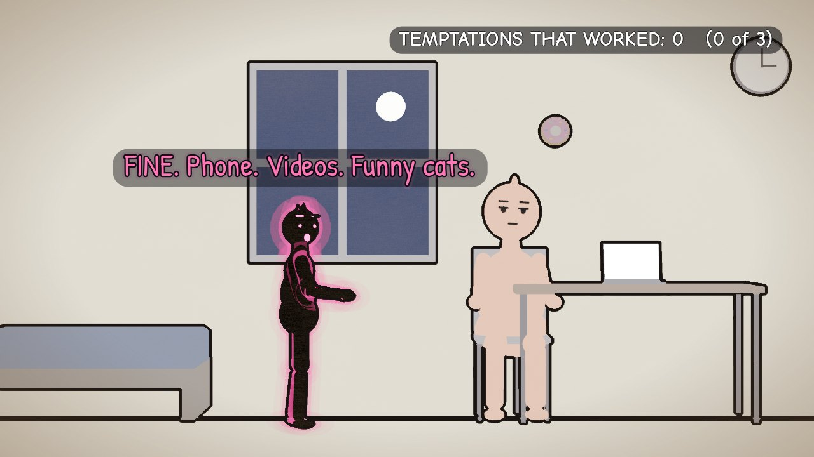
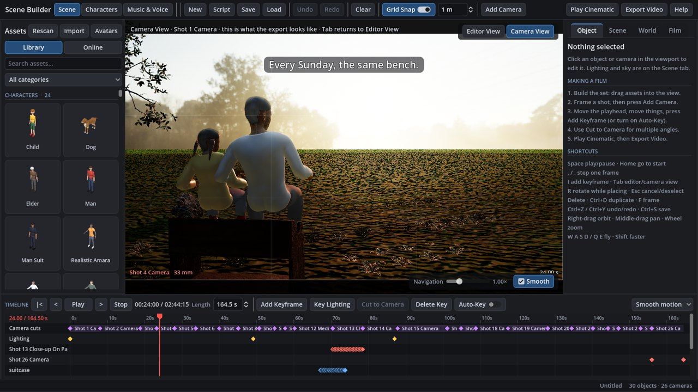

<div align="center">


# Scene Builder

**Write a story and get a finished 3D short film.**

A desktop 3D environment builder and cinematic movie maker for people who don't write code.
You can build a world by drag-and-drop, or write a short screenplay (yourself or with an AI)
and Scene Builder makes the film from it: the set, the actors, their movement and dialogue,
the camera shots, the music and the final video.




*From **Same Sunset**, a 3-minute film made with Scene Builder: realistic people, a Poly Haven photo sky and free CC0 models.*

[What it does](#what-it-does) · [Gallery](#gallery) · [Quick start](#quick-start) · [A film in 30 lines](#a-film-in-30-lines) · [User guide](docs/MANUAL.md) · [Changelog](CHANGELOG.md)

</div>

---

## What it does

Making even a one-minute animated film normally takes weeks of modelling, rigging, animating and
editing in tools built for professionals. Scene Builder does the routine parts for you, so you can
spend your time on the story.

| | |
|---|---|
| 🎬 **Script → film** | Write a short screenplay: who is in it, where they are, what they do and say, and which shots you want. One click builds the whole film, with walking, sitting, hugging, carrying, lip-synced dialogue, subtitles and camera cuts. |
| 🤖 **Works with any AI** | **Copy AI Instructions** gives Claude, ChatGPT or another AI the script format plus a list of everything installed in *your* app. Paste its script back and build. You can also write films offline with **Ollama** on your own computer, for free. |
| 🌍 **Worlds by drag-and-drop** | Terrain, plants, water, rivers, waterfalls, weather (rain, snow, mist, falling leaves), time of day, fire and smoke. There are 13 ready-made locations, from a lakeside campfire to a classroom and a news studio. |
| 🧑‍🤝‍🧑 **People** | Realistic motion-captured people, customisable stylised characters and animals. You can also build your own avatar from a photo with **Avatar Studio** (Blender + MPFB2), or bring in **Mixamo** characters and animations. |
| 📦 **Free online library** | Search and download thousands of free models, photo skies and ground textures from **Poly Haven**, **Poly Pizza** and **BlendKit** without leaving the app. Credits are written for you. |
| 🎥 **Real camera work** | Establishing shots, close-ups, two-shots, dolly, crane, push-in, follow, depth of field and letterbox. The automatic director avoids walls and keeps faces in frame, or you place every camera yourself. |
| 🎨 **Several looks** | Realistic, Cartoon, Sketchbook, Flat sketch, Paper, Silhouette short-film and Trailer/VFX. |
| 🎞️ **Export** | MP4 with music, sound and voices (via FFmpeg), AVI or PNG sequence, from 720p to 4K, plus vertical 9:16 and square. You can also hand the scene to **Blender Cycles** for the best possible quality. |

---

## Gallery

<table>
<tr>
<td width="50%"><br><sub><b>Same Sunset</b> · the last shot: three generations, one bench</sub></td>
<td width="50%"><br><sub><b>Same Sunset</b> · a close-up with depth of field</sub></td>
</tr>
<tr>
<td><br><sub><b>Rain</b> · night street, weather and practical lights</sub></td>
<td><br><sub><b>Tika</b> · silhouette short-film look</sub></td>
</tr>
<tr>
<td><br><sub><b>Just One More</b> · flat sketch look</sub></td>
<td><br><sub><b>Bad Influence</b> · paper look comedy</sub></td>
</tr>
</table>

<p align="center"><br>
<sub>The editor: asset library on the left, 3D view, inspector on the right, timeline below.</sub></p>

---

## Quick start

### Use the ready-made app (Windows)
1. Download `SceneBuilder-1.28-Windows.zip` from the [Releases](../../releases) page and unzip it.
2. Double-click **`SceneBuilder.exe`**. If Windows SmartScreen says "unknown publisher", choose *More info → Run anyway*.
3. Click **Script → Open…**, pick any `.zip` in the `Films` folder, then **Build Film → Watch**.

### Run from source
1. Install **[Godot 4.3+](https://godotengine.org/download)** (the standard build, not .NET).
2. Clone this repository, then in Godot choose **Import → `project.godot` → Import & Edit**.
3. Press **F5**.

Requirements: a GPU that runs Vulkan (most cards from the last ~8 years).

Optional helpers:
- **[FFmpeg](https://ffmpeg.org)** for MP4 export with sound.
- **[Blender](https://blender.org)** for Avatar Studio and Cycles rendering.
- **[Ollama](https://ollama.com)** for offline AI scripts.
- **[Piper](https://github.com/rhasspy/piper)** for natural voices.

---

## A film in 30 lines

```text
REQUIRES: Scene Builder 1.28
TITLE: Same Sunset
LOCATION: Blank World
VOICES: off

CAST:
Papa = realistic man, shirt #e9e4da
Mila = realistic girl, shirt #f2c94c

SET:
bench = my prop "Painted Wooden Bench" at (0, 0)
tree  = my prop "Island Tree 01" at (-3, -2)

SCENE 1: Every Sunday
LIGHT: photo sky spruit_sunrise_2k.hdr
TIME: 17.5
Mila is at (-1, -8)
Papa is at (0, -9)
Mila runs to bench
Papa walks to bench
Mila sits on bench, left
Papa sits on bench, right
SHOT: wide shot of Papa and Mila, from behind
CAPTION: "Every Sunday, the same bench." for 4s
WAIT 4s
SHOT: close-up on Mila
Mila: "Papa, where does the sun go?"
SHOT: close-up on Papa
Papa: "Somewhere far away. But it always comes back."
```

Paste it into **Script**, press **Build Film**, and Scene Builder sets up the world, places and
animates the people, frames each shot and times the cuts. (The bench, tree and sky are free Poly Haven
assets: download them once in **Library → Online** and **Scene → Sky**, or ship them inside a film
package.) Everything
it builds stays editable: you can move a camera, retime a key or change the light, then save.

- **Full script reference:** [User guide §4](docs/MANUAL.md#4-films-from-a-script)
- **Write whole film packages with an AI**, with props, music and sound included: [`FILM_PACKAGE_PROMPT.md`](FILM_PACKAGE_PROMPT.md)

---

## Included films

The [`examples/`](examples) folder holds ready-to-build film packages, including:

| Film | Length | What it shows |
|---|---|---|
| **The Surprise Test** | 5:47 | Classroom comedy: 9 characters, 97 shots, a paper plane and a frog chase |
| **Rain** | 3:50 | Realistic night street, a stranger and an umbrella |
| **Four Seasons on One Bench** | 3:00 | One bench through summer, autumn, winter and spring |
| **The Lantern Part Two** | 3:45 | Two locations, carrying, kneeling, rising sky lanterns |
| **The Last Momo** | ~3:00 | Family comedy: sneaking, a dance-off, props that vanish |
| **Just One More** | 1:27 | Flat sketch style: a glowing shadow whispers |
| **Bad Influence** | 2:40 | Paper look: a little temptation shadow fails at his first job |

Open any of them with **Script → Open…** and press **Build Film**.

---

## How it works

```
 screenplay ──► FilmScript ──► ScriptDirector ──────────────► KeyframeStore ──► Timeline ──► Export
 (text / AI)     (parser)      · builds the location & set      (every key)     (playback)   (MP4 / AVI /
                               · resolves places, seats, routes                                 PNG / Blender)
                               · plans movement, dialogue, lip sync
                               · frames shots, picks camera sides,
                                 avoids walls and blocked faces
```

- **Engine:** Godot 4 (GDScript), Forward+ renderer. The app is a single window, and Godot itself is never shown to the user.
- **Characters:** pose themselves on every seek from action keys, so playback, scrubbing and export always match frame for frame.
- **Undo:** every edit, including keyframes, goes through one undo history.
- **Save files:** readable JSON. Online assets are re-downloaded automatically on another computer.

The project structure, build steps and the headless test suite are described in
[User guide §18 — For developers](docs/MANUAL.md#18-for-developers).

### Building the app
```bash
godot --headless --export-release "Windows Desktop" build/windows/SceneBuilder.exe
```

### Running the tests
```bash
godot --headless res://tests/SmokeTest.tscn                     # builds and plays every template
godot --headless res://tests/ScriptTest.tscn -- examples/rain.zip  # builds a film, prints the report and shots
```

---

## Documentation

- **[User guide](docs/MANUAL.md)**: install, the window, scripts, packages, worlds, characters, cameras, timeline, export, shortcuts, troubleshooting.
- **[Changelog](CHANGELOG.md)**: what's new in every version.
- **[FILM_PACKAGE_PROMPT.md](FILM_PACKAGE_PROMPT.md)**: the complete brief for having an AI write a film package.

---

## Credits

- **Realistic people:** bodies from MakeHuman / MPFB data (CC0). Motion from the
  [CMU Graphics Lab Motion Capture Database](http://mocap.cs.cmu.edu) (BVH conversions by B. Hahne).
  *The database was created with funding from NSF EIA-0196217.* See [`assets/people/CREDITS.txt`](assets/people/CREDITS.txt).
- **Online library:** [Poly Haven](https://polyhaven.com) (CC0), [Poly Pizza](https://poly.pizza) (CC0 / CC-BY) and
  [BlendKit](https://www.blendkit.com). Downloaded models keep their own licences, and every export writes a credits file.
- **Mixamo** characters and animations can be used in your films, but their files are not redistributed here.
- Built-in assets, music and example films are original to Scene Builder.

<div align="center">

Made in Nepal 🇳🇵 by **Nabin** with Godot.

</div>
